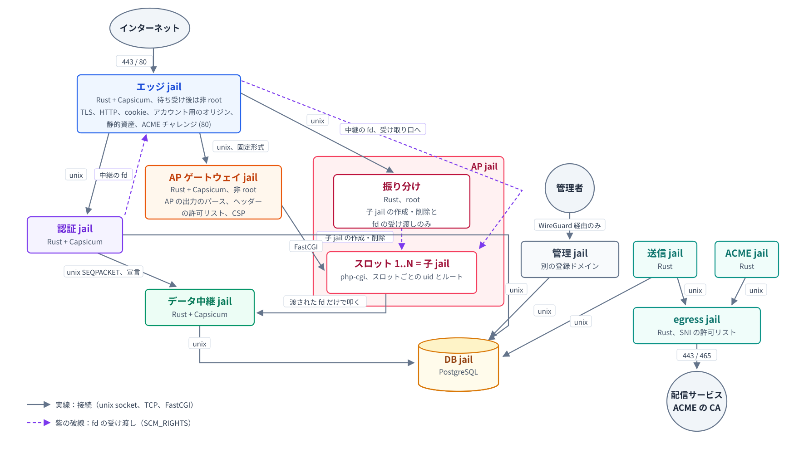

# 箱
**アプリが完全に乗っ取られても、被害は利用者のクリック1回分を超えない。**  
乗っ取られても、何もできなくすればいいというコンセプトで構築した。  
  
Webアプリを「検知と復旧」ではなく「何もできない場所にコードを閉じ込める」で守る設計と、その実測。  
  
合言葉は **deny all して allow**。  
  
前提は「アプリはもう乗っ取られている」。侵入の成否ではなく、被害の上限だけを見る。  

## 発想

- 入口は1つだけ。コードは読み取り専用で、リクエストごとに使い捨て
- 永続データには直接触れない。「対象×回数×操作の合図」で絞った接続だけが渡される
- ネットワークは無い。出口は1か所だけで、宛先は許可リスト制
- 管理はWireGuardの内側からしか届かない

土台はFreeBSDのjailと、渡したfdでしか触れないケイパビリティ型の考え方。中身はRustとPHP。

## 実測したこと

FreeBSD 15.1の実機で検証した。  
実行コマンドと出力の原文は[EVIDENCE.md](EVIDENCE.md)

| 試験 | 結果 |
| --- | --- |
| **app-rce**: メモアプリに `eval` の穴を開け、通常経路で攻撃コードを実行 | **ALL PASS**（2026-10-27、10-28 の2回） |
| **CVE-2012-1823**: パッチ前 PHP 5.3.11 の引数注入を jail 内で発火 | **ALL PASS**（2026-10-28） |
| **WordPress のデータ層**: WP 7.1.3 + MySQL 8.4、公開側はビュー経由の SELECT のみ | **ALL PASS**（2026-10-28） |
| 製品イメージの生成と起動 | 起動と応答のみ。**機能の確認であって、安全の証明ではない** |

app-rce の中身: 攻撃コードはスロット内（専用 uid、jail の中、/dev 無し）で実行された。だが宣言は「メモ取得1回」だけ。  
2回目は予算で弾かれ、他人のメモは forbidden。外向きの接続はできず、ホストのファイルは読めず、書いたファイルは次のリクエストで消えていた。

WordPress の中身: 公開側から見える記事は公開済みだけ。
下書き・非公開・パスワード付きは行ごと存在しない。パスワードのハッシュとメールアドレスは空、未承認コメントは見えず、書き込みは ERROR 1142 で遮断。

## 守ること / 守らないこと

守る:

- 宣言（対象×回数）を超えた永続データへのアクセス
- 侵入したコードの外向き通信（踏み台化）と、ホストや他人の
  ファイルの読み書き
- リクエストをまたいだ居座り（プロセスもファイルも残らない）
- 他の訪問者への応答の書き換え
- 非公開データ（下書き、ハッシュ、メールアドレス、未承認
  コメント）の公開側からの読み出し

守らない（ここを読み飛ばすと、この設計は嘘になる）:

- **カーネルの脆弱性**。境界はカーネル1枚で、箱そのもののバグも同じ
- **開いた画面の中のデータ**と、偽の表示や騙しリンク
- **保存データを経由した再感染**。管理側で書かれた内容は公開側がそのまま実行する
- **管理の箱が取られた場合**。管理側は意図的に素のまま
- **許可した宛先経由の持ち出し**、供給元の侵害、DoS、サイドチャネル

## できていること / やっていないこと

できている:

- 攻撃試験2種の実測（app-rce、CVE-2012-1823）と検証手順書
- WordPress のデータ層（ネットワーク無しの MySQL jail、公開ビューと権限の実測）

やっていない:

- 中継の本物の DB 接続と本物の認証（今はスタブ）
- エッジとゲートウェイの分離、pf、egress・管理・通知の jail
- WordPress を公開スロットで描画するところ（データ層の次）
- React2Shell の発火確認（受け側は構築済み。検証はしてない）

## 有識者に見てもらいたいところ

- 保証の文言と強制の仕組みの対応（言い過ぎている保証は無いか）
- 中継プロトコルをどこまで固定すれば「漏洩範囲はここまで」と言い切れるか
- 子 jail を作る root の部品（振り分け）の入力検証
- 操作の合図の証明。`Sec-Fetch-User` はナビゲーションにしか付かない。API ルートでの代替案が要る
- TLS 秘密鍵の置き場と、ECH で SNI が見えなくなる egress の前提
- WordPress のビューの絞り漏れ（プラグインの REST 等）

## 再現方法

FreeBSD 15.1 の環境だけあればよい。手順は
`src/image/verification.md`:

1. VM 構築とイメージ生成は §1〜§2、生成は `src/image/build-image.sh`
2. 安全性の確認は §3、攻撃試験は `src/tests/attack/`
3. WordPress は §5、DDL は `src/wordpress/wp-pub-views.sql`
4. 詰まったら `secure/knowledge/reproducibility.md`

日々の脆弱性対応には疲れた。I'm tired, boss.ってやつです。  
このような仕組みで止血ではなく、出血をしないことで対応に追われる生活から解放されるだろうか...。
